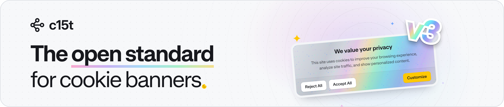

<p align="center">
  <a href="https://c15t.com?utm_source=github&utm_medium=repo_homepage" target="_blank" rel="noopener noreferrer">
    <picture>
      <source media="(prefers-color-scheme: dark)" srcset="docs/assets/c15t-banner-readme-dark.png">
      
    </picture>
  </a>
</p>

<p align="center">
  <a href="https://www.npmjs.com/package/c15t"><picture><source media="(prefers-color-scheme: dark)" srcset="https://shieldcn.dev/npm/c15t.svg?variant=outline&size=xs&mode=dark"></picture></a>
  <a href="https://github.com/c15t/c15t"><picture><source media="(prefers-color-scheme: dark)" srcset="https://shieldcn.dev/github/c15t/c15t/stars.svg?variant=outline&size=xs&mode=dark"></picture></a>
  <a href="https://github.com/c15t/c15t/blob/main/LICENSE.md"><picture><source media="(prefers-color-scheme: dark)" srcset="https://shieldcn.dev/github/c15t/c15t/license.svg?variant=outline&size=xs&mode=dark"></picture></a>
  <a href="https://c15t.link/discord"><picture><source media="(prefers-color-scheme: dark)" srcset="https://shieldcn.dev/discord/1312171102268690493.svg?variant=outline&size=xs&mode=dark"></picture></a>
  <a href="https://skills.sh/c15t/skills/c15t"><picture><source media="(prefers-color-scheme: dark)" srcset="https://shieldcn.dev/skills/c15t/skills/c15t.svg?variant=outline&size=xs&mode=dark"></picture></a>
  <a href="https://inth.com?utm_source=github&utm_medium=repo_homepage"><picture><source media="(prefers-color-scheme: dark)" srcset="https://shieldcn.dev/badge/Made%20By-Inth-ffc803.svg?size=xs&logo=data%3Aimage%2Fsvg%2Bxml%3Bbase64%2CPHN2ZyB4bWxucz0iaHR0cDovL3d3dy53My5vcmcvMjAwMC9zdmciIGZpbGw9Im5vbmUiIHZpZXdCb3g9IjAgMCAzOTMgNDAwIj48cGF0aCBmaWxsPSIjMDAwIiBkPSJNMTgyLjY2MiAwdjM2Ljg5NWgtNTkuMDMxdjgyLjczM2g1OS4wMzF2MzYuODkzSDI3LjQ4MnYtMzYuODkzaDU5LjAzVjM2Ljg5NWgtNTkuMDNWMHpNMzIxLjk0MSA4OS44NVYwaDM1LjM1NXYxNTYuNTIxaC0yNS43MTNsLTg2LjEzNy05MC4zNjR2OTAuMzY0aC0zNS4zNTVWMGgyNi4zNTV6Ii8%2BPHBhdGggZmlsbD0iIzAwMCIgZmlsbC1ydWxlPSJldmVub2RkIiBkPSJNMzE4LjU3MSAxODUuNzE0aDc0LjI4NlY0MDBIMFYxODUuNzE0aDI3Mi44NTd2LTQ3LjE0M3ptLTI5MS4wOSAyOC45Njl2MzcuMTE4aDU4LjEzN3YxMTkuNjI4aDM2Ljg5NVYyNTEuODAxaDU4LjU4NHYtMzcuMTE4em0xODIuNjEuMjI0djE1Ni41MjJoMzYuODk0VjMxMy41OWg3My4zNDF2NTcuODM5aDM3LjExOFYyMTQuOTA3aC0zNy4xMTh2NjEuNzg4aC03My4zNDF2LTYxLjc4OHoiIGNsaXAtcnVsZT0iZXZlbm9kZCIvPjwvc3ZnPg%3D%3D&color=ffc803&labelTextColor=000000&valueColor=000000&mode=dark"></picture></a>
</p>

c15t is the open standard for cookie banners. It's an open-source cookie consent manager and consent management platform (CMP) for JavaScript. You get a GDPR cookie banner, a preference dialog, and consent-gated scripts for React, Next.js, Vue, Nuxt, Svelte, Astro, TanStack Start, and plain HTML. Google Consent Mode v2 works through `@c15t/integrations`, and IAB TCF through an optional add-on.

c15t is used by [2,100+ sites](https://www.wappalyzer.com/technologies/cookie-compliance/c15t/), including expo.dev, zed.dev, unkey.dev, mintlify.com, and sazabi.com.

**[Docs](https://c15t.com/docs)** · **[Hosted on Inth](https://inth.com?utm_source=github&utm_medium=repo_homepage)** · **[Discord](https://c15t.link/discord)**

## Why c15t

- **Consent lives in your code.** The banner ships in your bundle and renders with your app, not from a third-party snippet that loads after your page.
- **Analytics, ads, and pixels follow each visitor's choice.** Ready-made loaders cover 40+ vendors, such as Google Tag Manager, GA4, Meta Pixel, and PostHog.
- **One setup for every region.** Policies decide who sees a banner: opt-in for visitors in the EU, opt-out for some US states, or rules that you write.
- **Server-rendered pages can ship the banner in the first HTML.** Next.js, Nuxt, Astro, TanStack Start, and SvelteKit resolve each visitor's policy on the server, so the banner does not wait for a request from the browser.
- **Standards built in:** Google Consent Mode v2, IAB TCF 2.4, IAB GPP, and Global Privacy Control.
- **Your design or ours.** Use the prebuilt components with a theme system, or build your own UI on headless hooks and composables.
- **Your data where you want it.** Keep consent records on Inth, on a backend you run, or in the browser only.

## Supported Frameworks

| Framework | Install | Import from | Quickstart |
| --- | --- | --- | --- |
| React 18 and 19 (Vite, React Router) | `c15t` | `c15t/react` | [React](https://c15t.com/docs/frameworks/react/quickstart) |
| Next.js 15 and 16 (App Router, Pages Router) | `c15t` | `c15t/next` | [Next.js](https://c15t.com/docs/frameworks/next/quickstart) |
| Vue 3 | `c15t` | `c15t/vue/vue-plugin` | [Vue](https://c15t.com/docs/frameworks/vue/quickstart) |
| Nuxt 3 and 4 | `c15t` | `c15t/vue` (Nuxt module) | [Nuxt](https://c15t.com/docs/frameworks/nuxt/quickstart) |
| Astro 5, 6, and 7 | `c15t` | `c15t/astro` | [Astro](https://c15t.com/docs/frameworks/astro/quickstart) |
| TanStack Start | `c15t` | `c15t/tanstack-start` | [TanStack Start](https://c15t.com/docs/frameworks/tanstack-start/quickstart) |
| Svelte 5 and SvelteKit | `c15t` | `c15t/svelte` | [Svelte](https://c15t.com/docs/frameworks/svelte/quickstart), [SvelteKit](https://c15t.com/docs/frameworks/sveltekit/quickstart) |
| JavaScript, headless | `c15t` | `c15t`, `c15t/runtime` | [Headless runtime](https://c15t.com/docs/frameworks/javascript/headless) |
| Script tag, no build step (Webflow, WordPress, Framer, Squarespace) | `@c15t/browser` | `<script>` from a CDN | [HTML](https://c15t.com/docs/frameworks/html/quickstart) |

## Hosting

c15t needs somewhere to keep policies and consent records. Pick one:

- **Hosted on [Inth](https://inth.com?utm_source=github&utm_medium=repo_homepage)**: Inth runs the backend for you. You get policy storage, consent records, audit history, and a dashboard, with no database or server to run. Sign-up is free.
- **Self-hosted**: Run [`@c15t/backend`](./packages/backend) on your own server with PostgreSQL, MySQL, or SQLite. You own migrations, backups, and uptime. See the [self-hosting guide](https://c15t.com/docs/self-host/quickstart).
- **Offline**: Choices stay in the browser, with no consent records. Use it for local development, previews, and demos, not production.

The frontend code is the same for Inth and a self-hosted backend. Only the backend URL changes.

## Example

A Next.js App Router app with the prebuilt banner, the preference dialog, and PostHog held until the visitor allows measurement. Install c15t and the vendor loaders:

```bash
pnpm add c15t @c15t/integrations
```

Set `NEXT_PUBLIC_C15T_BACKEND_URL` to your Inth backend URL in `.env.local`, then add three files:

```ts
// next.config.ts
import { withConsentManifest } from 'c15t/next/build'
import type { NextConfig } from 'next'

const nextConfig = {} satisfies NextConfig

// Downloads your policy at build time and finds c15t.config.ts
export default withConsentManifest(nextConfig)
```

```ts
// c15t.config.ts
import { posthog } from '@c15t/integrations/posthog'
import { defineConsentConfig } from 'c15t/next'

export default defineConsentConfig({
  scripts: [
    posthog({
      id: 'phc_your_project_key',
      initOptions: { cookieless_mode: 'never' },
      loadMode: 'after-consent',
    }),
  ],
})
```

```tsx
// app/layout.tsx
import {
  ConsentBanner,
  ConsentDialog,
  ConsentDialogLink,
  ConsentRoot,
} from 'c15t/next'
import { resolveConsent } from 'c15t/next/server'
import type { ReactNode } from 'react'

import './globals.css'

const RootLayout = ({ children }: { children: ReactNode }) => (
  <html lang="en">
    <body>
      {/* Not awaited: the page renders while consent resolves. */}
      <ConsentRoot state={resolveConsent()}>
        {children}
        <ConsentBanner />
        <ConsentDialog />
        <footer>
          <ConsentDialogLink>Privacy settings</ConsentDialogLink>
        </footer>
      </ConsentRoot>
    </body>
  </html>
)

export default RootLayout
```

The layout stays a Server Component. You write no `'use client'` wrapper and need no c15t stylesheet import. The [Next.js quickstart](https://c15t.com/docs/frameworks/next/quickstart) walks through each file. The quickstart for each other framework has the same example.

## Integrations

[`@c15t/integrations`](./packages/integrations) has a loader for each vendor below. Most wait until the visitor allows the vendor's consent category. A few, such as Google Tag Manager and Mixpanel, load at once and pass the choice to the vendor's own consent API. The [integrations overview](https://c15t.com/docs/integrations/overview) shows what each loader does.

- **Tag managers**: Google Tag Manager, Cloudflare Zaraz
- **Analytics**: Google tag (GA4 and Google Ads), Adobe Analytics, Ahrefs Analytics, Amplitude, Clay, Cloudflare Web Analytics, Databuddy, Fathom, Heap, Hightouch, Hotjar, LogRocket, Lucky Orange, Matomo, Microsoft Clarity, Mixpanel, OneDollarStats, Pendo, Pirsch, Plausible, PostHog, Promptwatch, RB2B, RudderStack, Rybbit, Segment, Statable, Umami, Vercel Analytics, Vercel Speed Insights
- **Experimentation and personalization**: Adobe Target, Appcues, Dynamic Yield, Optimizely Web Experimentation, Wisepops
- **Ads and pixels**: AdRoll, Meta Pixel, OpenAI Pixel, TikTok Pixel, LinkedIn Insight Tag, LiveIntent, Microsoft UET, Pinterest Tag, Reddit Pixel, Snapchat Pixel, The Trade Desk, Vector, X Pixel
- **Enrichment, email, and SMS**: Attentive, Clearbit, Customer.io, Insider, Klaviyo, Marketo Munchkin, Salesforce Account Engagement
- **Chat and support**: Ada, Intercom, Crisp, Front Chat, Gorgias Chat, Zendesk Messaging
- **Monitoring**: Sentry
- **Embeds**: YouTube and Google Maps, with no extra package

## Packages

| Package | Use it for | Version |
| --- | --- | --- |
| [`c15t`](./packages/c15t) | The package most apps install. The consent engine plus the React, Next.js, Vue, Nuxt, Astro, and TanStack Start adapters | <a href="https://www.npmjs.com/package/c15t"><picture><source media="(prefers-color-scheme: dark)" srcset="https://shieldcn.dev/npm/c15t.svg?variant=outline&size=sm&mode=dark"></picture></a> |
| [`@c15t/core`](./packages/core) | Headless consent engine: policies, storage, and script gating. Also in `c15t` | <a href="https://www.npmjs.com/package/@c15t/core"><picture><source media="(prefers-color-scheme: dark)" srcset="https://shieldcn.dev/npm/@c15t/core.svg?variant=outline&size=sm&mode=dark"></picture></a> |
| [`@c15t/react`](./packages/react) | React 18 and 19 components and hooks. Also at `c15t/react` | <a href="https://www.npmjs.com/package/@c15t/react"><picture><source media="(prefers-color-scheme: dark)" srcset="https://shieldcn.dev/npm/@c15t/react.svg?variant=outline&size=sm&mode=dark"></picture></a> |
| [`@c15t/nextjs`](./packages/nextjs) | Next.js 15 and 16, App Router and Pages Router, with server rendering. Also at `c15t/next` | <a href="https://www.npmjs.com/package/@c15t/nextjs"><picture><source media="(prefers-color-scheme: dark)" srcset="https://shieldcn.dev/npm/@c15t/nextjs.svg?variant=outline&size=sm&mode=dark"></picture></a> |
| [`@c15t/vue`](./packages/vue) | Vue 3 plugin and Nuxt 3 and 4 module. Also at `c15t/vue` | <a href="https://www.npmjs.com/package/@c15t/vue"><picture><source media="(prefers-color-scheme: dark)" srcset="https://shieldcn.dev/npm/@c15t/vue.svg?variant=outline&size=sm&mode=dark"></picture></a> |
| [`@c15t/astro`](./packages/astro) | Astro 5, 6, and 7, with a banner that ships no framework JavaScript. Also at `c15t/astro` | <a href="https://www.npmjs.com/package/@c15t/astro"><picture><source media="(prefers-color-scheme: dark)" srcset="https://shieldcn.dev/npm/@c15t/astro.svg?variant=outline&size=sm&mode=dark"></picture></a> |
| [`@c15t/tanstack-start`](./packages/tanstack-start) | TanStack Start, with the banner in the first HTML. Also at `c15t/tanstack-start` | <a href="https://www.npmjs.com/package/@c15t/tanstack-start"><picture><source media="(prefers-color-scheme: dark)" srcset="https://shieldcn.dev/npm/@c15t/tanstack-start.svg?variant=outline&size=sm&mode=dark"></picture></a> |
| [`@c15t/svelte`](./packages/svelte) | Svelte 5 and SvelteKit through `c15t/svelte` | <a href="https://www.npmjs.com/package/@c15t/svelte"><picture><source media="(prefers-color-scheme: dark)" srcset="https://shieldcn.dev/npm/@c15t/svelte.svg?variant=outline&size=sm&mode=dark"></picture></a> |
| [`@c15t/browser`](./packages/browser) | One script tag for Webflow, WordPress, Framer, Squarespace, and plain HTML | <a href="https://www.npmjs.com/package/@c15t/browser"><picture><source media="(prefers-color-scheme: dark)" srcset="https://shieldcn.dev/npm/@c15t/browser.svg?variant=outline&size=sm&mode=dark"></picture></a> |
| [`@c15t/integrations`](./packages/integrations) | Consent-aware loaders for 40+ analytics, ad, chat, and monitoring vendors | <a href="https://www.npmjs.com/package/@c15t/integrations"><picture><source media="(prefers-color-scheme: dark)" srcset="https://shieldcn.dev/npm/@c15t/integrations.svg?variant=outline&size=sm&mode=dark"></picture></a> |
| [`@c15t/iab`](./packages/iab) | IAB TCF 2.4 and GPP for programmatic advertising | <a href="https://www.npmjs.com/package/@c15t/iab"><picture><source media="(prefers-color-scheme: dark)" srcset="https://shieldcn.dev/npm/@c15t/iab.svg?variant=outline&size=sm&mode=dark"></picture></a> |
| [`@c15t/translations`](./packages/translations) | Banner and dialog text in 53 languages | <a href="https://www.npmjs.com/package/@c15t/translations"><picture><source media="(prefers-color-scheme: dark)" srcset="https://shieldcn.dev/npm/@c15t/translations.svg?variant=outline&size=sm&mode=dark"></picture></a> |
| [`@c15t/ui`](./packages/ui) | The primitives, CSS, and theme tokens behind the c15t components | <a href="https://www.npmjs.com/package/@c15t/ui"><picture><source media="(prefers-color-scheme: dark)" srcset="https://shieldcn.dev/npm/@c15t/ui.svg?variant=outline&size=sm&mode=dark"></picture></a> |
| [`@c15t/backend`](./packages/backend) | The self-hosted consent backend, for PostgreSQL, MySQL, or SQLite | <a href="https://www.npmjs.com/package/@c15t/backend"><picture><source media="(prefers-color-scheme: dark)" srcset="https://shieldcn.dev/npm/@c15t/backend.svg?variant=outline&size=sm&mode=dark"></picture></a> |
| [`@c15t/node-sdk`](./packages/node-sdk) | Read and write consent records from your server | <a href="https://www.npmjs.com/package/@c15t/node-sdk"><picture><source media="(prefers-color-scheme: dark)" srcset="https://shieldcn.dev/npm/@c15t/node-sdk.svg?variant=outline&size=sm&mode=dark"></picture></a> |
| [`@c15t/dev-tools`](./packages/dev-tools) | Inspect consent state while you develop | <a href="https://www.npmjs.com/package/@c15t/dev-tools"><picture><source media="(prefers-color-scheme: dark)" srcset="https://shieldcn.dev/npm/@c15t/dev-tools.svg?variant=outline&size=sm&mode=dark"></picture></a> |
| [`@c15t/schema`](./packages/schema) | Valibot schemas and TypeScript types for the consent API | <a href="https://www.npmjs.com/package/@c15t/schema"><picture><source media="(prefers-color-scheme: dark)" srcset="https://shieldcn.dev/npm/@c15t/schema.svg?variant=outline&size=sm&mode=dark"></picture></a> |
| [`@c15t/logger`](./packages/logger) | The structured logger that c15t packages use | <a href="https://www.npmjs.com/package/@c15t/logger"><picture><source media="(prefers-color-scheme: dark)" srcset="https://shieldcn.dev/npm/@c15t/logger.svg?variant=outline&size=sm&mode=dark"></picture></a> |

To set up c15t from the terminal, run `inth c15t` from the [Inth CLI](https://c15t.com/docs/cli/overview). It starts your coding agent with the c15t setup prompt or writes your framework's quickstart files.

[`@c15t/scripts`](./packages/scripts) is deprecated. It re-exports `@c15t/integrations` for older imports and goes away in v4.

## Docs for AI Agents

Every package that has docs ships them as Markdown, matched to the installed version. After you install c15t, point your coding agent at `node_modules/c15t/AGENTS.md`.

On the web, every page of the [c15t docs](https://c15t.com/docs) has a Markdown version, and [llms.txt](https://c15t.com/docs/llms.txt) lists them all. Install the c15t agent skills with `npx skills add c15t/skills`.

## Talk

Watch the Next.js Conf 2025 talk: [Why Your Consent Banner Should Be in Your Bundle](https://c15t.link/talk).

## Develop c15t

This repo uses [Bun](https://bun.sh) and Turborepo. [AGENTS.md](./AGENTS.md) has the full command list.

```bash
bun install
bun run dev          # the demo app in apps/playground
bun run build        # every package
bun run test         # packages affected by your changes
```

## Support

- Join our [Discord community](https://c15t.link/discord)
- Open an issue on our [GitHub repository](https://github.com/c15t/c15t/issues)
- Visit [inth.com](https://inth.com?utm_source=github&utm_medium=repo_homepage) and use the chat widget
- Email our support team at [support@inth.com](mailto:support@inth.com)

## Contributing

- Read the [contribution guidelines](https://c15t.com/docs/oss/contributing) before you open a pull request
- Follow the [code of conduct](https://c15t.com/docs/oss/code-of-conduct)

## Security

Do not open a public issue for a security vulnerability. Report it privately through [GitHub's vulnerability reporting](https://github.com/c15t/c15t/security/advisories/new). We examine every valid report.

- Do not share the vulnerability in public forums, issues, or pull requests
- Give the steps to reproduce it and the versions it affects
- Give us time to release a fix before you disclose it

## License

[Apache License 2.0](https://github.com/c15t/c15t/blob/main/LICENSE.md)

---

**Built by [Inth](https://inth.com?utm_source=github&utm_medium=repo_homepage)**
