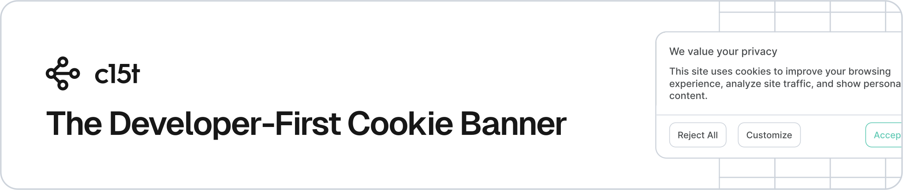

<p align="center">
  <a href="https://c15t.com?utm_source=npm&utm_medium=readme&utm_campaign=oss_readme&utm_content=c15t" target="_blank" rel="noopener noreferrer">
    <picture>
      <source media="(prefers-color-scheme: dark)" srcset="../../docs/assets/c15t-banner-readme-dark.svg" type="image/svg+xml">
      
    </picture>
  </a>
</p>

# c15t: Consent Management for Every JavaScript Framework

<p>
<a href="https://www.npmjs.com/package/c15t"><picture><source media="(prefers-color-scheme: dark)" srcset="https://shieldcn.dev/npm/c15t.svg?variant=outline&mode=dark"></picture></a>
<a href="https://github.com/c15t/c15t"><picture><source media="(prefers-color-scheme: dark)" srcset="https://shieldcn.dev/github/c15t/c15t/stars.svg?variant=outline&mode=dark"></picture></a>
<a href="https://github.com/c15t/c15t/blob/main/LICENSE.md"><picture><source media="(prefers-color-scheme: dark)" srcset="https://shieldcn.dev/github/c15t/c15t/license.svg?variant=outline&mode=dark"></picture></a>
<a href="https://c15t.link/discord"><picture><source media="(prefers-color-scheme: dark)" srcset="https://shieldcn.dev/discord/1312171102268690493.svg?variant=outline&mode=dark"></picture></a>
<a href="https://skills.sh/c15t/skills/c15t"><picture><source media="(prefers-color-scheme: dark)" srcset="https://shieldcn.dev/skills/c15t/skills/c15t.svg?variant=outline&mode=dark"></picture></a>
<a href="https://inth.com?utm_source=npm&utm_medium=readme&utm_campaign=oss_readme&utm_content=c15t"><picture><source media="(prefers-color-scheme: dark)" srcset="https://shieldcn.dev/badge/Made%20By-Inth-ffc803.svg?color=ffc803&labelTextColor=000000&logo=data%3Aimage%2Fsvg%2Bxml%3Bbase64%2CPHN2ZyB4bWxucz0iaHR0cDovL3d3dy53My5vcmcvMjAwMC9zdmciIGZpbGw9Im5vbmUiIHZpZXdCb3g9IjAgMCAzOTMgNDAwIj48cGF0aCBmaWxsPSIjMDAwIiBkPSJNMTgyLjY2MiAwdjM2Ljg5NWgtNTkuMDMxdjgyLjczM2g1OS4wMzF2MzYuODkzSDI3LjQ4MnYtMzYuODkzaDU5LjAzVjM2Ljg5NWgtNTkuMDNWMHpNMzIxLjk0MSA4OS44NVYwaDM1LjM1NXYxNTYuNTIxaC0yNS43MTNsLTg2LjEzNy05MC4zNjR2OTAuMzY0aC0zNS4zNTVWMGgyNi4zNTV6Ii8%2BPHBhdGggZmlsbD0iIzAwMCIgZmlsbC1ydWxlPSJldmVub2RkIiBkPSJNMzE4LjU3MSAxODUuNzE0aDc0LjI4NlY0MDBIMFYxODUuNzE0aDI3Mi44NTd2LTQ3LjE0M3ptLTI5MS4wOSAyOC45Njl2MzcuMTE4aDU4LjEzN3YxMTkuNjI4aDM2Ljg5NVYyNTEuODAxaDU4LjU4NHYtMzcuMTE4em0xODIuNjEuMjI0djE1Ni41MjJoMzYuODk0VjMxMy41OWg3My4zNDF2NTcuODM5aDM3LjExOFYyMTQuOTA3aC0zNy4xMTh2NjEuNzg4aC03My4zNDF2LTYxLjc4OHoiIGNsaXAtcnVsZT0iZXZlbm9kZCIvPjwvc3ZnPg%3D%3D&valueColor=000000&mode=dark"></picture></a>
</p>

c15t is an open-source consent management platform (CMP). One package gives you a cookie banner, a preference dialog, and consent-gated scripts for React, Next.js, Vue, Nuxt, Astro, TanStack Start, and plain JavaScript. Keep consent records on [Inth](https://inth.com?utm_source=github&utm_medium=readme&utm_content=c15t), on a backend you run, or in the browser only.

c15t is used by [2,100+ sites](https://www.wappalyzer.com/technologies/cookie-compliance/c15t/), including expo.dev, zed.dev, unkey.dev, mintlify.com, and sazabi.com.

## Key Features

- One install for every framework: `c15t` brings the consent engine and the React, Next.js, Vue, Nuxt, Astro, and TanStack Start adapters, always at the same version
- Analytics, ads, pixels, and embeds follow each visitor's choice. Ready-made loaders cover 40+ vendors, such as Google Tag Manager, GA4, Meta Pixel, and PostHog
- Policies decide who sees a banner: opt-in for visitors in the EU, opt-out for some US states, or rules that you write
- On server-rendered Next.js, Nuxt, Astro, and TanStack Start pages, the banner is in the first HTML, so it does not appear late
- Google Consent Mode v2, IAB TCF 2.4, and Global Privacy Control support
- Prebuilt components with a theme system, or headless hooks and composables for your own design
- Framework peer dependencies are optional, so a plain JavaScript project does not install React, Vue, or Astro

## Supported Frameworks

| Framework | Import from | Quickstart |
| --- | --- | --- |
| JavaScript, headless | `c15t`, `c15t/runtime` | [Headless runtime](https://c15t.com/docs/frameworks/javascript/headless) |
| React 18 and 19 (Vite, React Router) | `c15t/react` | [React](https://c15t.com/docs/frameworks/react/quickstart) |
| Next.js 15 and 16 (App Router, Pages Router) | `c15t/next` | [Next.js](https://c15t.com/docs/frameworks/next/quickstart) |
| Vue 3 | `c15t/vue/vue-plugin` | [Vue](https://c15t.com/docs/frameworks/vue/quickstart) |
| Nuxt 3 and 4 | `c15t/vue` (Nuxt module) | [Nuxt](https://c15t.com/docs/frameworks/nuxt/quickstart) |
| Astro 5, 6, and 7 | `c15t/astro` | [Astro](https://c15t.com/docs/frameworks/astro/quickstart) |
| TanStack Start | `c15t/tanstack-start` | [TanStack Start](https://c15t.com/docs/frameworks/tanstack-start/quickstart) |
| Svelte 5 and SvelteKit | [`@c15t/svelte`](https://www.npmjs.com/package/@c15t/svelte), a separate install | [Svelte](https://c15t.com/docs/frameworks/svelte/quickstart), [SvelteKit](https://c15t.com/docs/frameworks/sveltekit/quickstart) |
| Script tag, no build step (Webflow, WordPress, Framer, Squarespace) | [`@c15t/browser`](https://www.npmjs.com/package/@c15t/browser), a separate install | [HTML](https://c15t.com/docs/frameworks/html/quickstart) |

Not sure which one fits? [Choose your setup](https://c15t.com/docs/concepts/choose-your-setup) compares the options by framework, rendering mode, and hosting.

## Hosting

c15t needs somewhere to keep policies and consent records. Pick one:

- **Hosted on [Inth](https://inth.com?utm_source=npm&utm_medium=readme&utm_campaign=oss_readme&utm_content=c15t)**: Inth runs the backend for you. You get policy storage, consent records, audit history, and a dashboard, with no database or server to run. Sign-up is free.
- **Self-hosted**: Run [`@c15t/backend`](https://www.npmjs.com/package/@c15t/backend) on your own server with PostgreSQL, MySQL, or SQLite. You own migrations, backups, and uptime. See the [self-hosting guide](https://c15t.com/docs/self-host/quickstart).
- **Offline**: Choices stay in the browser, with no consent records. Use it for local development, previews, and demos, not production.

The frontend code is the same for Inth and a self-hosted backend. Only the backend URL changes.

## Prerequisites

- Node.js 20.19 or later
- An [Inth project](https://inth.com) (free sign-up), a [self-hosted backend](https://c15t.com/docs/self-host/quickstart), or offline mode for local development

## Installation

```bash
pnpm add c15t
```

Then follow the quickstart for your framework in [Supported Frameworks](#supported-frameworks). Each subpath is the same code as its scoped package, so `c15t/react` and `@c15t/react` are interchangeable.

## Usage

1. Set your Inth backend URL. In a Vite app, use `VITE_C15T_BACKEND_URL`
2. Wrap your app in `ConsentProvider` and add the banner, the dialog, and a link that opens the dialog again
3. Add vendor loaders to `scripts` so each one waits for its consent category

```tsx
// src/consent.tsx (React)
import { posthog } from '@c15t/integrations/posthog'
import {
  ConsentBanner,
  ConsentDialog,
  ConsentDialogLink,
  ConsentProvider,
  hosted,
} from 'c15t/react'
import type { ReactNode } from 'react'

import 'c15t/react/styles.css'

const options = {
  mode: hosted(), // reads VITE_C15T_BACKEND_URL
  scripts: [posthog({ id: 'phc_your_project_key', loadMode: 'after-consent' })],
}

export const Consent = ({ children }: { children: ReactNode }) => (
  <ConsentProvider options={options}>
    {children}
    <ConsentBanner />
    <ConsentDialog />
    <ConsentDialogLink>Privacy settings</ConsentDialogLink>
  </ConsentProvider>
)
```

## Documentation

See the [documentation](https://c15t.com/docs) for guides, API reference, and examples.

## Package Map

| `c15t` subpath | Same code as |
| --- | --- |
| `c15t`, `c15t/runtime`, `c15t/build` | [`@c15t/core`](https://www.npmjs.com/package/@c15t/core) |
| `c15t/react` | [`@c15t/react`](https://www.npmjs.com/package/@c15t/react) |
| `c15t/next` | [`@c15t/nextjs`](https://www.npmjs.com/package/@c15t/nextjs) |
| `c15t/vue` | [`@c15t/vue`](https://www.npmjs.com/package/@c15t/vue) |
| `c15t/astro` | [`@c15t/astro`](https://www.npmjs.com/package/@c15t/astro) |
| `c15t/tanstack-start` | [`@c15t/tanstack-start`](https://www.npmjs.com/package/@c15t/tanstack-start) |

The scoped packages stay published and supported. Use them when you want to pin one adapter on its own.

## Related Packages

- [@c15t/integrations](https://www.npmjs.com/package/@c15t/integrations): consent-aware loaders for Google Tag Manager, GA4, Meta Pixel, PostHog, and 40+ other vendors
- [@c15t/iab](https://www.npmjs.com/package/@c15t/iab): IAB TCF 2.4 and GPP for programmatic advertising
- [@c15t/backend](https://www.npmjs.com/package/@c15t/backend): the self-hosted consent backend
- [@c15t/node-sdk](https://www.npmjs.com/package/@c15t/node-sdk): read and write consent records from your server
- [@c15t/cli](https://www.npmjs.com/package/@c15t/cli): set up c15t, run migrations, and install agent skills

## Docs for AI Agents

This package ships its documentation as Markdown, matched to the installed version. After you install it, point your coding agent at `node_modules/c15t/AGENTS.md`. It indexes every guide in `node_modules/c15t/docs/`.

On the web, every page of the [c15t docs](https://c15t.com/docs) has a Markdown version, and [llms.txt](https://c15t.com/docs/llms.txt) lists them all. Install the c15t agent skills with `npx skills add c15t/skills`.

## Support

- Join our [Discord community](https://c15t.link/discord)
- Open an issue on our [GitHub repository](https://github.com/c15t/c15t/issues)
- Visit [inth.com](https://inth.com) and use the chat widget
- Contact our support team via email [support@inth.com](mailto:support@inth.com)

## Contributing

- Read the [contribution guidelines](https://c15t.com/docs/oss/contributing) before you open a pull request
- Follow the [code of conduct](https://c15t.com/docs/oss/code-of-conduct)

## Security

Do not open a public issue for a security vulnerability. Report it privately through [GitHub's vulnerability reporting](https://github.com/c15t/c15t/security/advisories/new). We examine every valid report.

- Do not share the vulnerability in public forums, issues, or pull requests
- Give the steps to reproduce it and the versions it affects
- Give us time to release a fix before you disclose it

## License

[Apache License 2.0](https://github.com/c15t/c15t/blob/main/LICENSE.md)

---

**Built by [Inth](https://inth.com?utm_source=npm&utm_medium=readme&utm_campaign=oss_readme&utm_content=c15t)**
